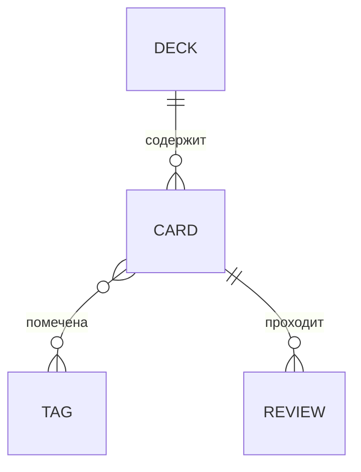
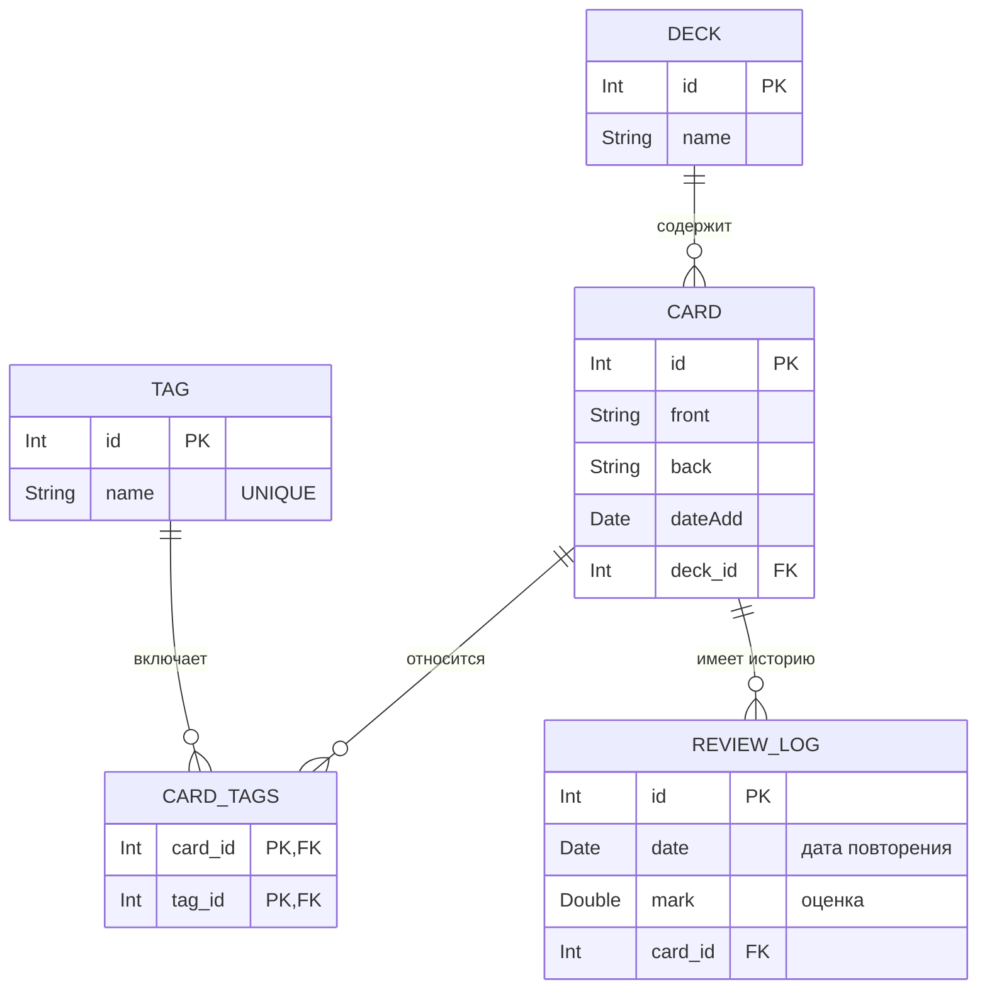

# Флип — карточки для изучения английских слов

Учебное iOS-приложение на **SwiftUI**: колоды карточек со словами, которые можно переворачивать и смахивать — вправо «знаю», влево «не знаю». Сделано для практики анимаций и управления состоянием в SwiftUI.

<p align="center">
  
  
  
  
</p>

## Возможности

- **Колоды** — сетка колод с кольцами прогресса, цель дня, серия занятий
- **Обучение** — карточка переворачивается по тапу и смахивается свайпом; штампы «ЗНАЮ / НЕ ЗНАЮ» проявляются по мере движения пальца
- **Отмена** — можно вернуть предыдущую карточку, ответ откатывается
- **Результат** — процент правильных ответов, статистика, список слов на повтор и конфетти за хороший результат
- **Повтор ошибок** — новая сессия только из карточек с ответом «не знаю»

## Анимации

| Где | Что используется |
|---|---|
| Кольца прогресса | `trim(from:to:)` + `withAnimation(.easeInOut)` в `onAppear` |
| Появление плиток колод | каскад через `.delay(index * 0.08)` |
| Нажатие на плитки и кнопки | свой `ButtonStyle` + `scaleEffect` + `.spring` |
| Пульсирующий огонёк | `.animation(_:body:)` + `repeatForever` |
| Капсула в таббаре | `matchedGeometryEffect` |
| Переворот карточки | `rotation3DEffect` по оси Y, смена сторон в середине поворота |
| Свайп карточки | `DragGesture` → `offset` + `rotationEffect` |
| Улёт и появление карточек | `withAnimation { } completion: { }`, `.id` + `.transition` + `.zIndex` |
| Счётчики | `.contentTransition(.numericText())` |
| Звезда на экране результата | `phaseAnimator` |
| Конфетти | случайные кусочки + `.spring` |

## Архитектура

```
Flip/
├─ Models/        Card, Deck, склонение «слово/слова/слов»
├─ Store/         DeckStore — ObservableObject с @Published колодами
├─ Views/         DecksView, StudyView, ResultView
├─ Components/    DeckTile, ProgressRing, FlipCard, CardFront, CardBack,
│                 TabBar, PressableStyle
├─ Theme/         палитра и шрифты
├─ Extensions/    свайп «назад» при скрытой панели навигации
└─ Fonts/         Unbounded, Manrope
```

- `DeckStore` создаётся через `@StateObject` в `FlipApp` и передаётся экранам через `@ObservedObject`
- Локальное состояние экранов — `@State`, переворот карточки передаётся в `FlipCard` через `@Binding`
- Экран обучения получает `id` колоды и находит её в store, чтобы всегда видеть актуальные данные
- `ResultView` ничего не знает о store: получает готовые числа и замыкания `onRepeat` / `onClose`

## Требования

- Xcode 26+
- iOS 26.5+

## Запуск

1. Клонировать репозиторий
2. Открыть `Flip.xcodeproj`
3. Выбрать симулятор iPhone и нажать **Run** (⌘R)

Если сборка просит команду разработки — в настройках таргета **Signing & Capabilities** выбрать свою команду.

## Расширение: свои колоды и карточки

Следующий шаг развития — пользователь сам создаёт колоды и карточки и повторяет материал в любое время. Перед реализацией модель данных спроектирована по этапам: инфологическая → даталогическая модель с нормализацией → физическая.

### 1. Инфологическая модель

Описывает предметную область без привязки к СУБД: сущности, их смысловые атрибуты и связи. Типов данных, внешних ключей и связующих таблиц на этом уровне нет.



| Сущность | Атрибуты |
|---|---|
| Колода (Deck) | название |
| Карточка (Card) | вопрос, ответ, дата создания |
| Тег (Tag) | название (уникально) |
| Повторение (Review) | дата, оценка |

### 2. Даталогическая (реляционная) модель

- каждая сущность становится таблицей с первичным ключом;
- связь 1:N реализуется внешним ключом на стороне «много» (`deck_id` в Card, `card_id` в ReviewLog);
- связь M:N между Card и Tag реализуется связующей таблицей `Card_tags` с составным ключом.



#### Нормализация

Модель строилась от одной универсальной сущности с последовательной нормализацией.

- **1НФ.** Все атрибуты атомарны. Теги вынесены в отдельную таблицу, а не хранятся строкой `"swift, sql"` внутри карточки.
- **2НФ.** Неключевые атрибуты зависят от всего ключа. В `Card_tags` неключевых атрибутов нет, в остальных таблицах ключ простой.
- **3НФ.** Нет транзитивных зависимостей. Название колоды хранится только в Deck, а не дублируется в каждой карточке.

### Этапы

- [x] Инфологическая модель
- [x] Даталогическая модель и нормализация
- [ ] Физическая модель
- [ ] MVP: колоды, карточки, повторение в случайном порядке
- [ ] Интервальное повторение (SM-2) и история повторений
- [ ] Теги и повторение по тегу
- [ ] Статистика
- [ ] Перенос старых данных (английские слова) на новую схему

## Планы

- [ ] Сохранение прогресса между запусками (`Codable` + `UserDefaults`)
- [ ] Настоящие «Цель дня» и «Серия дней»
- [ ] Экраны «Статистика» и «Профиль»
- [ ] Создание своих колод

## Шрифты

- [Unbounded](https://fonts.google.com/specimen/Unbounded) — SIL Open Font License 1.1
- [Manrope](https://fonts.google.com/specimen/Manrope) — SIL Open Font License 1.1
